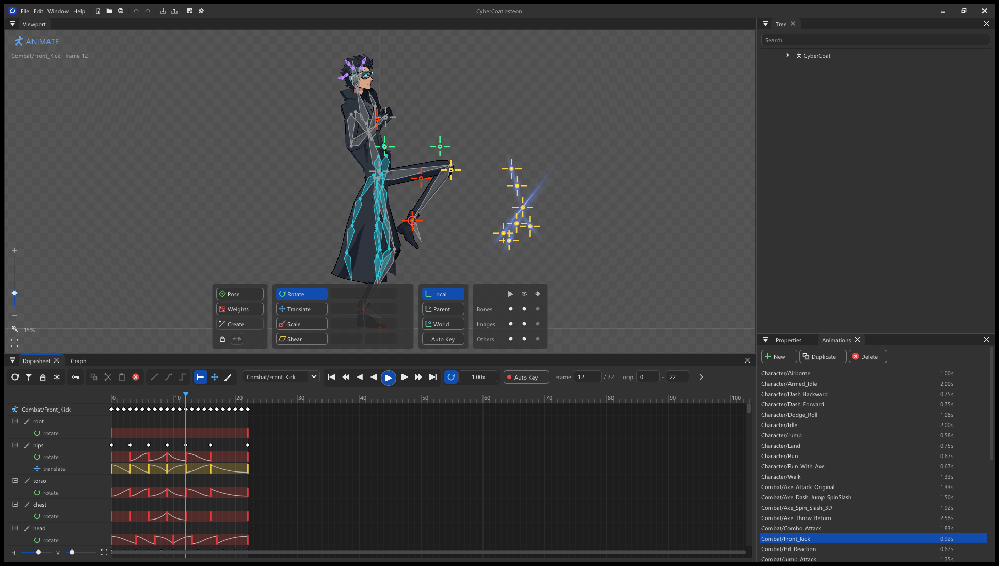
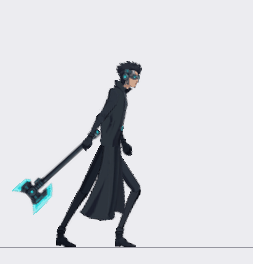
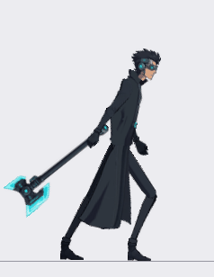
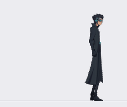
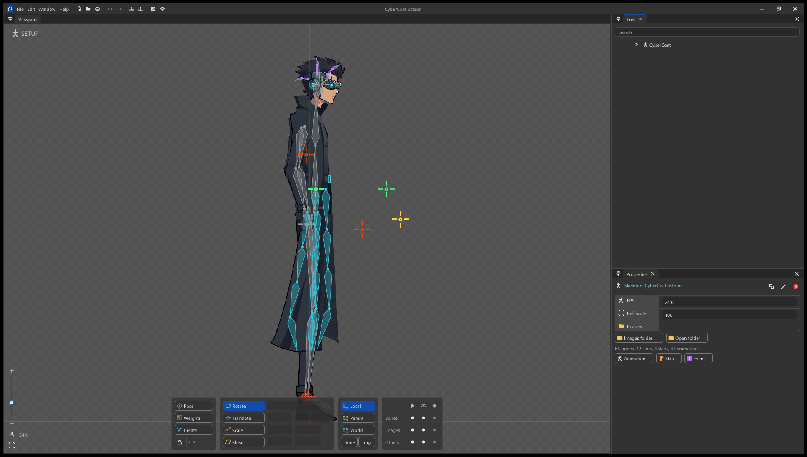

<div align="center">


# Osteon2D

**A free, open-source 2D skeletal animation editor for Windows.**

Rig characters with bones, deform them with meshes and weights, and animate them on a dopesheet and graph editor.

[](https://github.com/Divyash93/Osteon2D/releases/latest)
[](LICENSE)


[Download](#download) · [Showcase](#showcase) · [Features](#features) · [Runtimes](#runtimes) · [Languages](#languages) · [Build](#build-from-source) · [License](#license)

**Read this in:** English · [हिन्दी](docs/translations/README.hi.md) · [Español](docs/translations/README.es.md) · [简体中文](docs/translations/README.zh-CN.md) · [日本語](docs/translations/README.ja.md) · [Português (BR)](docs/translations/README.pt-BR.md)

</div>

---

<p align="center"></p>

## What is Osteon2D?

Osteon2D is a native desktop editor for building skeletal 2D animation: you draw a bone hierarchy over your artwork, attach images or meshes to the bones, and key poses over time. The result plays back smoothly at any size and with far less art than frame-by-frame animation.

It is one small native executable (C++20, Win32, Direct3D 11, Dear ImGui). There is no browser, no runtime to install and no account to create, and it starts instantly.

> **Inspired by Spine, not a copy of it.** Osteon2D is inspired by [Spine](https://esotericsoftware.com) from Esoteric Software, a tool we admire. It does **not** intend to replicate the whole of Spine, and it is not trying to. It is its own project with its own code and its own direction. Where it makes sense, it reads and writes the publicly documented Spine JSON format so that work can move between tools. See [Legal](#legal).

## Showcase

Everything below was rigged and animated in Osteon2D: one character (CyberCoat, 66 bones, 42 slots, 37 animations) with a cape that follows through, a hoverboard, an axe with a glowing trail and impact effects. The GIFs are rendered from the project.

<p align="center">
  
  
  
</p>

<p align="center"></p>
<p align="center"><sub>The same character in Setup mode: the bone hierarchy over the artwork.</sub></p>

## Download

Get the latest installer from the **[Releases page](https://github.com/Divyash93/Osteon2D/releases/latest)**.

| File | What it is |
|---|---|
| `OsteonSetup.exe` | Installer. Installs for the current user (no admin rights), adds Start Menu and Desktop shortcuts, a `.ost` file association and an uninstall entry. |
| `Osteon-0.1.0-win64.zip` | Portable build. Unzip and run `Osteon.exe`. |

**Requirements:** Windows 10 or 11 (x64) and a Direct3D 11 GPU. Without a suitable GPU it falls back to the WARP software renderer.

Osteon2D is early software (**version 0.1.0**). It is already usable for real rigs, but expect rough edges and please report anything you find. [`PROGRESS.md`](PROGRESS.md) lists honestly what is done, what is checked and what is still missing.

## Features

### Rigging
- Bones with all five inherit modes, slots, skins, draw order, bone icons, multi-selection and set-parent.
- Pose and Create tools; Rotate, Translate, Scale and Shear tools with on-canvas gizmos whose size you can change in Settings.
- Empty (zero-length) bones for pivots and controllers, shown as a crosshair.

### Art
- Region attachments, meshes, linked meshes, bounding boxes, clipping, points and Bezier paths.
- Mesh tools: Modify, Create, Delete, New and Trace (Detail, Concavity, Refinement), plus Generate and Apply.
- Sequences for frame-by-frame images.
- **Import:** Photoshop **PSD** files (each layer becomes a slot), a single image, several images at once, or a whole images folder.

### Weights
- Bind, Auto, Smooth, Prune, Swap and locks; Direct and Brush painting with pies and overlays, and a warning ring on vertices that exceed the influence limit.

### Constraints
- IK (one and two bone, softness, stretch, compress), transform, path and physics constraints, with keyable properties, Simulate and Reset.

### Animation
- Setup and Animate modes with Auto Key.
- Dopesheet with overview, filters, lock, sync, box scaling, copy and paste; graph editor with Bezier handles; ghosting; a preview with mixing.

### Interface and safety
- Dockable panels, a dark theme and a light theme, typed-value sliders, rulers, a zooming checkerboard.
- Undo and redo for every edit.
- Auto-save with crash recovery, and a crash report you can attach to bug reports.

### Output
- `.ost` projects, Spine JSON (4.2 and 4.3 layouts), experimental binary `.skel`, PNG sequences, animated GIFs, video, and a MaxRects texture atlas packer and unpacker.

## Runtimes

A runtime is the small library a game uses to load and play your animations. Osteon2D ships runtimes in [`runtimes/`](runtimes) (see [`runtimes/README.md`](runtimes/README.md) for exactly what each one supports):

| Engine / platform | Status |
|---|---|
| Godot 4 | GDScript core (loader, skeleton, IK, transform constraints, timelines, AnimationState) checked against the C++ engine with headless Godot; rendering node `Osteon2DSprite` |
| Unity | C# core checked against the C++ engine; `SkeletonAnimation` renderer, importers and shaders written but **not yet run inside a real Unity editor** |
| Web, libGDX, Cocos, SDL and custom C / C++ engines | Planned |

They read the Spine JSON that Osteon2D exports. File > Export > Binary also writes a compact `.skel`; that writer is **experimental** and has only been checked by round trip through Osteon2D's own reader, not against Esoteric's loaders. The animation engine in [`src/engine/`](src/engine) has no UI code, which makes it the natural starting point for a C++ runtime and for ports to other languages.

If you want to help build a runtime, open an issue and tell us which engine you care about.

## Languages

- **Documentation:** this README is available in English, Hindi, Spanish, Simplified Chinese, Japanese and Brazilian Portuguese (links above). Translation improvements are very welcome.
- **Editor interface:** Settings > General > Language switches the UI between English, Spanish, French, German, Brazilian Portuguese, Hindi, Simplified Chinese and Japanese. Menus, panels, labels, tooltips in Settings and the Settings dialog are translated; status messages and long help texts stay in English. Hindi is drawn without text shaping (an ImGui limitation), and Hindi, Chinese and Japanese use Windows system fonts. Translations live in [`src/editor/tr_*.inc`](src/editor); corrections are very welcome by issue or pull request.

## Quick start

1. Open **File > Import PSD...** to bring in layered artwork, or **File > Import Multiple Images...** for loose PNGs (or **File > Import Data...** for an existing Spine JSON).
2. Press **N** (Create) and drag in the viewport to create bones. A bone created while another is selected becomes its child.
3. Select an image, press **P** and click a bone to parent it. Rotate (**C**), translate (**V**), scale (**X**) and shear (**Z**) with the toolbar or by dragging.
4. Press **Ctrl+Tab** for Animate mode. With **Auto Key** on, every change is keyed at the current frame. Scrub the dopesheet ruler and press **D** to play.
5. Ease keys in the **Graph** view (Linear, Stepped, Bezier presets, draggable handles).
6. **Ctrl+S** saves an `.ost` project. **Ctrl+E** exports JSON, PNG sequences or GIFs. **Ctrl+P** packs a texture atlas.

All hotkeys are listed under **Help > Hotkeys (F1)**.

## Build from source

Prerequisite: Visual Studio 2022 with the "Desktop development with C++" workload (CMake and Ninja come with it).

```bat
build.bat            :: Release build -> build\Osteon.exe
build.bat test       :: build, then run the engine and editor test suites
```

Or open the folder in Visual Studio ("Open Folder"), which uses `CMakeLists.txt` directly. To package the installer and portable zip (this runs the tests first):

```powershell
powershell -ExecutionPolicy Bypass -File package.ps1
```

### Repository layout

| Path | Contents |
|---|---|
| `src/engine/` | Animation engine (no UI): data model, skeleton, constraints, animation, JSON, geometry |
| `src/editor/` | Win32 / Direct3D 11 / ImGui editor |
| `tests/` | Engine tests and editor document tests |
| `third_party/` | Dear ImGui and nlohmann/json (both MIT), see [`THIRD_PARTY_NOTICES.md`](THIRD_PARTY_NOTICES.md) |
| `installer/` | Per-user installer and uninstaller |
| `docs/translations/` | Translated READMEs |
| `ARCHITECTURE.md`, `PROGRESS.md`, `SPINE_CHECKLIST.md` | Design, status and the comparison checklist |

## Contributing

Issues and pull requests are welcome. Please run `build.bat test` before sending a change and keep new behaviour covered by a test where it can be (`tests/` for the engine, `tests/editor/` for document logic). [`ARCHITECTURE.md`](ARCHITECTURE.md) explains how the engine and editor fit together.

## License

Osteon2D is released under the **[MIT License](LICENSE)**: free to use, modify and distribute, including commercially, as long as the copyright notice is kept. Third-party code keeps its own licences; see [`THIRD_PARTY_NOTICES.md`](THIRD_PARTY_NOTICES.md). Your own artwork and animations are yours; Osteon2D claims no rights over what you make with it.

The name "Osteon2D" and its logo are the author's and are not granted by the MIT License.

## Legal

- Osteon2D is an **independent** project. It is **not affiliated with, endorsed by or sponsored by Esoteric Software**. "Spine" is a trademark of Esoteric Software LLC and is used here only to say what inspired this project and which file format it can read and write.
- Osteon2D was written from scratch. The Spine editor was examined only as a running program and through its public documentation and file format; its code was never decompiled.
- Osteon2D reads and writes the publicly documented Spine JSON format. If you ship **Spine runtimes** inside a product, the [Spine Runtimes License](https://esotericsoftware.com/spine-runtimes-license) applies to those runtimes, and you are responsible for complying with it.
- Photoshop is a trademark of Adobe Inc. Osteon2D reads the documented PSD file format and is not affiliated with Adobe.

---

<div align="center">

Made by [Divyash](https://github.com/Divyash93). If Osteon2D is useful to you, a star on the repository helps others find it.

</div>
